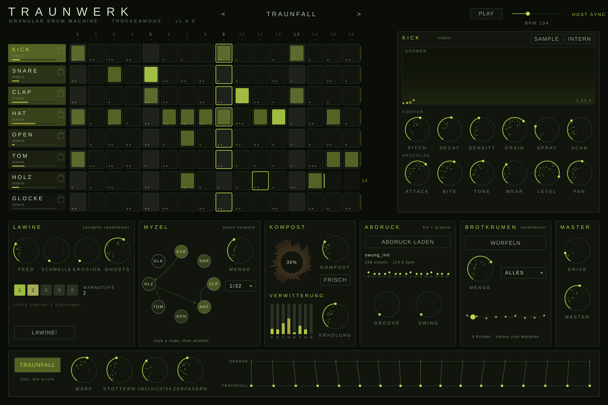

# TRAUNWERK — granular drum machine (VST3 / AU / LV2 / Standalone)

Part of the **trockenmoos** Salzkammergut series. Free.
Download page: <https://www.trockenmoos.com/plugins/>

Eight drum voices that aren't sample players. Each hit is a **grain cloud**, and
the sequencer has a few things other drum machines don't: a sandpile that sets
off avalanches, a fungal network that grows hits out of other hits, voices that
wear out, and a kit that slowly feeds on its own output.



## What's in it

| | |
|---|---|
| **ANSCHLAG / KÖRPER** | Every hit has two layers. ANSCHLAG plays the first few ms of the source straight, so the transient stays sharp. KÖRPER is the grain cloud behind it. Granular drums usually smear their attack; this split avoids that. Measured: crest factor in the first 3 ms is **3.4 with ANSCHLAG vs 0.4 without**. |
| **Density envelope** | DECAY doesn't fade the volume. It thins out the *grain rate*. A thick burst cracks, a thin trickle rustles. |
| **VERWITTERUNG** (WEAR, ERHOLUNG) | Each voice wears down with every hit (shorter, thinner grains, darker tone, slight drift and drop in pitch) and recovers during rests. A snare roll gets tired. Measured: at full wear a 16th roll ends up **~17× darker** than an unworn one, and is back to 8× brighter after a 3 s rest. |
| **KOMPOST** | The machine's output goes into a 4 s ring buffer. Body grains can read from the moment *this voice was last heard there*, so the kit gradually feeds on its own past. FRISCH clears it. Stable: 3 min at 100 % with Lawine and Myzel at full stays at a constant level. |
| **LAWINE** | A sandpile model (Bak–Tang–Wiesenfeld) on the 8×16 grid. FEED drops grains each 16th (two on active steps). When a cell reaches SCHWELLE, it tips into its neighbours. Tipped cells leave **ghost notes** (rings in the grid) that play the next time the playhead passes. EROSION lets avalanches flip steps permanently. The result is long calm stretches and occasional fills. Measured: of 486 avalanches, half tipped ≤ 2 cells, 7 % tipped ≥ 12. LAWINE! forces one. The WARNSTUFE 1–5 display shows how loaded the slope is. |
| **MYZEL** | Threads between voices. When a voice plays, it can send a spore along each thread that sprouts into a hit after 1/32 … 1/8 (up to four generations, each weaker). Click a node, then its targets, to grow threads (each click cycles the strength); right-click a node to cut its threads. In *Myzelgeflecht*, 4 seeded hits per bar grow ~3 more. |
| **ABDRUCK** | Load any recording. TRAUNWERK finds the hits, takes **a kit** (one slice per voice, chosen by brightness), **a groove** (micro-timing and accents per 16th) and **a pattern skeleton** (KICK / SNARE / HAT from the low, mid and high energy per step). Measured: tempo within 0.3 %. A 20 % swing comes back as 0.12–0.20 (deliberately conservative, see below). The pattern is a starting point, not a transcription. Busy, very granular material gives a looser skeleton, and offsets the hits don't agree on get pulled towards zero. |
| **BROTKRUMEN** | WÜRFELN randomises pattern (MUSTER), sound (KLANG) or both plus the network (ALLES), using musical templates per voice. Every throw leaves a crumb on the trail. Drag along the trail to **morph** between crumbs (sound blends continuously, steps switch half-way). |
| **TRAUNFALL** (switchable) | Time that breaks, named after the Traun rapids that salt boats once had to shoot. **WARP** bends time inside each bar: the 16ths stretch and rush along a curve that changes from bar to bar, while every downbeat stays exactly on the host grid (measured: 0.02 ms error, no steps lost or doubled). **STOTTERN** turns hits into ratchets of 2–6, even, rushing or bunched, rising or fading. **UMSCHICHTEN** makes rows read their pattern from shifted or random positions. **ZERFASERN** gives every hit its own small variation of pitch, grain, density, decay, scan and pan. Off = exactly the straight machine. The display shows the straight grid above the bent one. |
| **SCHUTZ** | The padlock on each row protects a voice from the randomizer, the trail, erosion and Abdruck. Sand doesn't fall there either. |
| **Polymeter** | Each row has its own length (shift-click a step, or right-click → length). |

### Grid
- Click a step: off → hit → accent. Alt-click sets an accent directly. Drag to paint.
- Click a voice name to select it (and hear it). Right-click it to load a sample, return to the built-in sound, lock it or clear the row.
- Drop an audio file onto a row to load it into that voice (leading silence is trimmed so ANSCHLAG lands on the transient).

### Sync & MIDI
- Follows the host transport. Without a running host (or in the standalone), use PLAY and the BPM slider.
- MIDI notes trigger the voices: GM map KICK 36, SNARE 38, CLAP 39, HAT 42, OPEN 46, TOM 45, HOLZ 37, GLOCKE 56. Any other note plays voice `(note − 36) mod 8`. Velocity is respected. HAT chokes OPEN.

### Presets
Init · Moos Minimal · Trommelweiber · Sägewerk Steeg · Glöckler · Lawinenhang · Myzelgeflecht · Kompost · Krippenstein Breaks · Traunfall

The built-in kit is synthesised in code, so there are no sample files to ship. Loaded samples are referenced by path in the project, not embedded.

## Build

```bash
cmake -B build -DCMAKE_BUILD_TYPE=Release
cmake --build build --config Release --parallel
```

JUCE 8.0.4 is fetched automatically. Formats per platform: VST3 + Standalone everywhere, AU on macOS, LV2 on Linux. `.github/workflows/build.yml` builds Windows, macOS (universal) and Linux on every push. A `v*` tag attaches zips to a GitHub release. Platform notes are the same as for [Sporalia](https://github.com/trockenmoos-droid/sporalia#build) (unsigned macOS builds: right-click → Open, or `xattr -dr com.apple.quarantine Traunwerk.vst3`).

## Test

```bash
cmake -B build -DTRAUNWERK_BUILD_TESTS=ON && cmake --build build --target TraunwerkRender
./build/TraunwerkRender_artefacts/Release/TraunwerkRender render
```

Renders every preset through a simulated host transport and checks level, stability and CPU. Then it measures each feature against a control (with/without ANSCHLAG, wear 0/1, feed 0/0.6, Myzel 0/0.85, Kompost 0/0.9, the trail round trip, TRAUNFALL timing measured sample-exact on the engine's own trigger clock, Abdruck on its own render and on a swung loop, the state round trip, a 3-minute torture run). It also writes demo WAVs and the screenshot above. It runs in CI on Linux. CPU per preset in the test: 1–4 % of one core.

## Credits

Idea, concept and testing: Christoph Campregher (trockenmoos).
Code: written entirely by Claude (Anthropic) in conversation. See [DEVLOG.md](DEVLOG.md) for how it was built.
